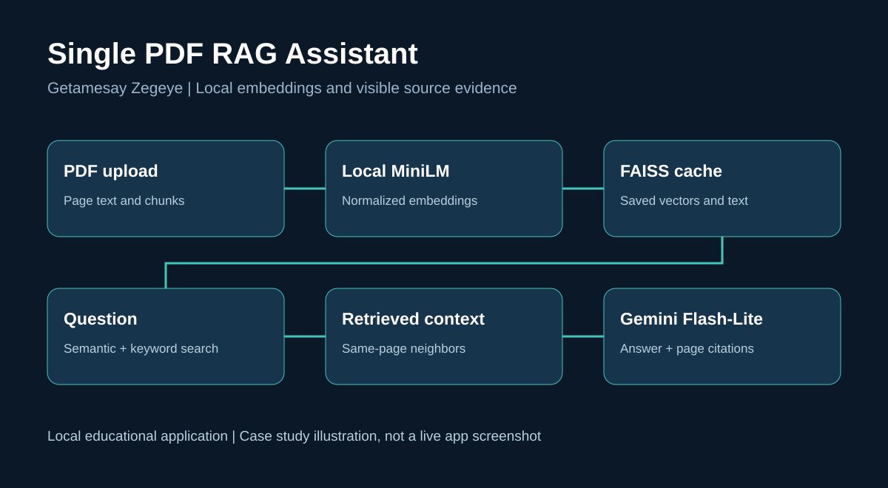

# Single PDF RAG Assistant


Ask questions about one PDF and inspect the passages supporting each answer.
Built by **Getamesay Zegeye** using Streamlit, local MiniLM sentence embeddings,
FAISS, and Gemini Flash-Lite.



## What this project demonstrates

- Single-PDF upload with page-preserving, overlapping word chunks.
- Local `sentence-transformers/all-MiniLM-L6-v2` embeddings on CPU.
- Normalized vectors stored in a persistent local FAISS `IndexFlatIP` index.
- Hybrid retrieval: semantic candidates plus keyword candidates weighted by term rarity.
- Same-page neighbor expansion, duplicate removal, and document-order context.
- Gemini answers with page references and an expandable evidence panel.
- Cache identity based on PDF content, embedding model, and chunk settings.

## Evaluation and evidence boundary

| Configuration | Result | Evidence status |
|---|---|---|
| Semantic-search baseline | 11/12 questions passed | Manually reviewed answers shared during development |
| Hybrid retrieval and neighbors | 12/12 questions passed | Developer-reported full retest on the same 12 questions |

The set contains seven direct questions, two synthesis questions, and three
missing-information questions about *Attention Is All You Need*. Q7 initially
missed hardware evidence on page 7; hybrid retrieval recovered it. This set was
used to improve the system and is a development/regression set, not an unseen
benchmark. **12/12 is not a general accuracy guarantee.** No production deployment,
independent end-to-end reproduction, or average latency result is claimed.

The release source is reconstructed from the supplied starter and the changes
recorded during development; the final local app.py and all final retest outputs
were not supplied. Rerun acceptance checks against this exact source before tagging
an evaluated release. See [evaluation report](docs/EVALUATION.md).

## Run on Windows with VS Code

Use Python 3.12 and open this project folder in VS Code.

```powershell
py -3.12 -m venv .venv
.\.venv\Scripts\python.exe -m pip install --upgrade pip
.\.venv\Scripts\python.exe -m pip install -r requirements.txt
Copy-Item .env.example .env
```

Edit `.env` and set your Google API key, then run:

```powershell
.\.venv\Scripts\python.exe -m streamlit run app.py
```

Upload one text-based PDF, click **Process PDF**, enter a question, and click
**Ask**. First use downloads MiniLM weights; embeddings subsequently run locally.
Gemini receives your question and retrieved passages and still needs API access
and available generation quota. The previous Google embedding quota is not used.

## Reuse the saved index

After restarting, upload the same PDF and click Process PDF. The app loads its
FAISS index and JSON chunk metadata from `indexes/<content-hash>/`. Prompt and
retrieval changes do not require rebuilding embeddings. Do not reuse indexes
created with a different embedding model. Delete `indexes/` to remove saved text
and embeddings. Do not commit `.env`, indexes, or private PDFs.

## Check the code

```powershell
.\.venv\Scripts\python.exe -m unittest discover -s tests -v
.\.venv\Scripts\python.exe -m pip freeze > requirements-lock.txt
```

The tests exercise chunk overlap, cache identity, keyword recovery, deduplication,
and page boundaries without network calls or model downloads. They do not test
answer quality or replace full integration tests. Dependency ranges are provided;
a dependency lock is only created after installation in your own environment.

## Documentation

- [Technical report](docs/TECHNICAL_REPORT.md)
- [Architecture and data flow](docs/ARCHITECTURE.md)
- [Evaluation methodology and results](docs/EVALUATION.md)
- [Windows setup and troubleshooting](docs/SETUP_AND_TROUBLESHOOTING.md)
- [30 interview questions and answers](interview/30_Interview_Questions_and_Answers.md)
- [Short CV project entry](career/CV_Short.md)
- [Detailed CV project entry](career/CV_Detailed.md)
- [LinkedIn post and project description](career/LINKEDIN.md)
- [Portfolio case study](career/PORTFOLIO_CASE_STUDY.md)

## Limitations and next work

Text extraction may interleave columns or distort tables and equations. Scanned
PDFs need OCR. MiniLM may truncate token-heavy passages. Hybrid retrieval is a
union of candidate sets, not BM25 or learned reranking; final context can exceed
k and has no token-budget cap. Citations are model-generated and need review.
There is no access control, multi-user data isolation, OCR, or multi-PDF upload.
An unrelated question can still retrieve passages because there is no calibrated
relevance gate. Unseen-document evaluation, bounded reranking, and context budgets
are the next priorities.

## Sources and attribution

- [Sentence Transformers documentation](https://www.sbert.net/docs/sentence_transformer/usage/usage.html)
- [MiniLM model card](https://huggingface.co/sentence-transformers/all-MiniLM-L6-v2)
- [FAISS](https://github.com/facebookresearch/faiss)
- [Google Gen AI SDK](https://googleapis.github.io/python-genai/)
- [Streamlit documentation](https://docs.streamlit.io/)
- [Attention Is All You Need](https://arxiv.org/abs/1706.03762)

Research PDFs and model weights are not bundled. Use material you may process and
review third-party licenses before redistribution. No open-source license grant is
selected for the project's original source in this package.
