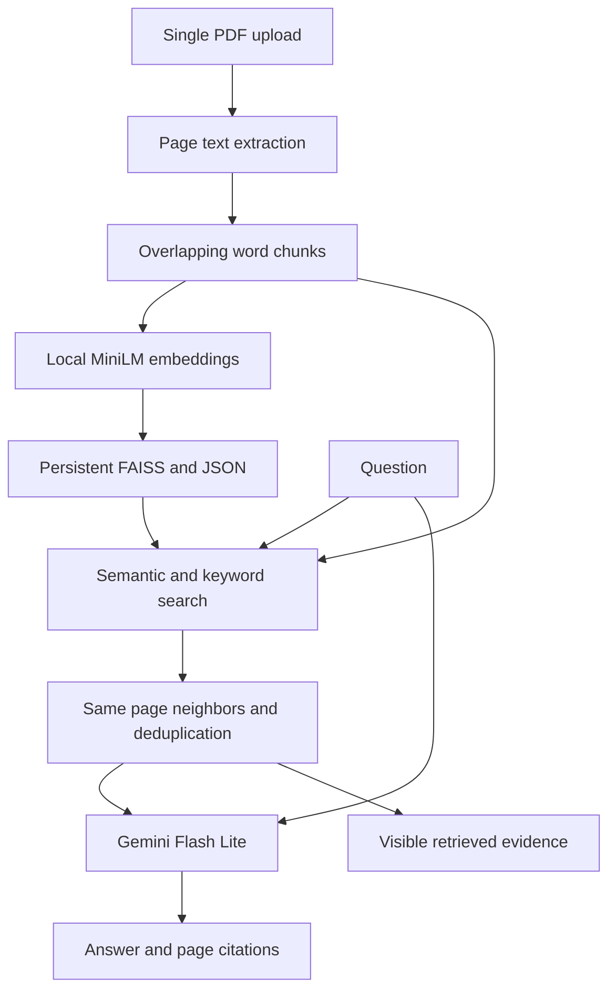

# Architecture

## Indexing

The PDF is read in memory. Each page is extracted separately; 120-word windows
advance by 95 words, preserving a 25-word overlap. Page numbers use one-based PDF
positions. MiniLM encodes each chunk on CPU. Vectors are normalized before insertion
into FAISS IndexFlatIP, so inner-product ranking corresponds to cosine similarity.

The cache key hashes PDF bytes, model name and chunk settings. The saved FAISS
file and JSON chunk list contain document-derived data. Only app-created local
cache files should be loaded. The model name is not a pinned revision, so future
weight changes are a reproducibility limitation.

## Retrieval

The question is encoded with the same MiniLM model. FAISS returns up to k semantic
candidate IDs. Keyword search tokenizes the question and each chunk, removes a
small stopword list and sums log(1 + N/(1 + df)) for matching query terms. Up to k
keyword candidates are unioned with semantic candidates. Immediate neighbors on
the same page are added, duplicate IDs removed, and IDs sorted in document order.

This is a simple hybrid baseline: there is no stemming, BM25 length normalization,
reciprocal-rank fusion, cross-encoder reranking, or final context budget. The slider
sets candidates per method, not the final number of returned passages.

## Generation and data boundary

Only the question and selected extracted text are sent to Google's generation API.
Document and query embeddings remain local after the model download. The request
uses a 60,000 ms timeout and one attempt. The UI reports errors; it does not promise
that every request completes within an exact wall-clock duration. Page citations
are requested in the prompt and are not automatically verified.

## Deployment boundary

The app was run locally by the developer. The portfolio page is a case study;
it does not host the Python app or provide a live inference endpoint.
